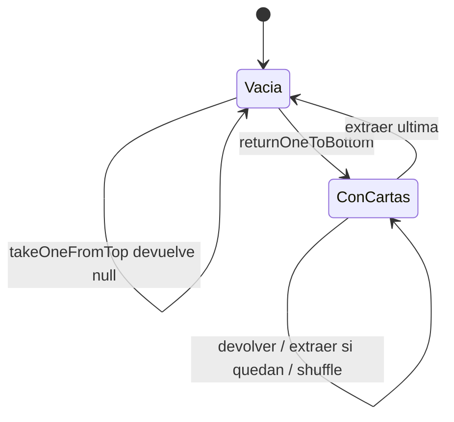
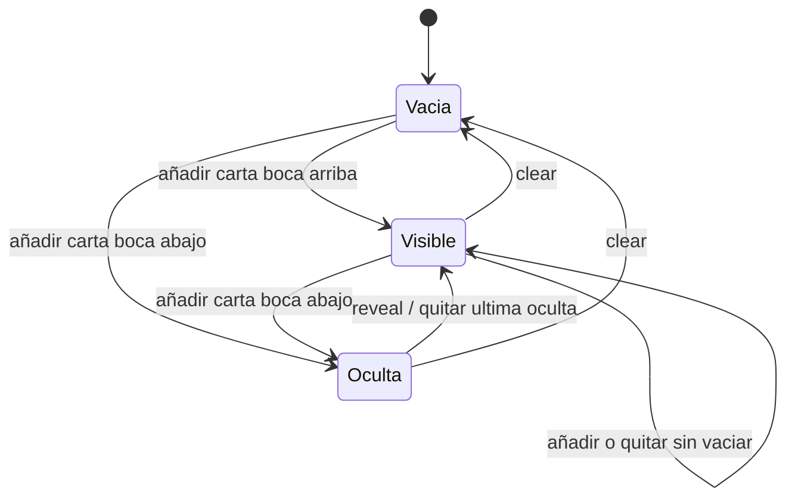
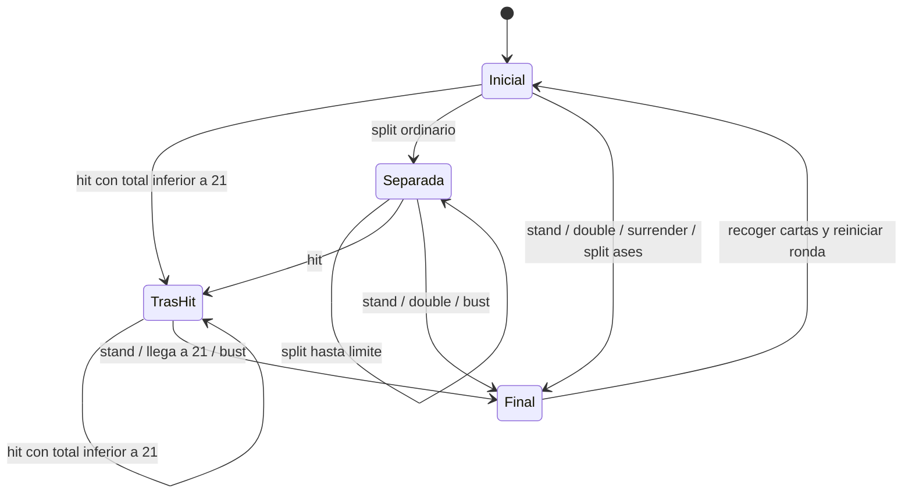

# Modelos de estado y escenarios

Modelo abstracto de las operaciones públicas, no extracción automática del código.
Se modelan dimensiones independientes para evitar el producto cartesiano de
banderas. La cobertura declarada se limita a estas abstracciones.

## Baraja

`DeckTest.emptyDeckReturnsNull`, `returnsInFifoOrder`, `depletionAndRefill` y
`shufflePreservesContents` cubren estados y transiciones representadas.

## Mano: contenido y visibilidad

`HandTest`: `addsCard`, `hiddenCardHidesHand`, `revealChangesVisibility`,
`removesExistingCard`, `clearEmptiesHand`, `clearResetsVisibility`.
`HandDefectTest.BUG004...` revela que quitar la última carta oculta no actualiza
la visibilidad. Cubrir una transición no implica que su implementación sea correcta.
La dimensión de as se cubre con vacío → as → as+número → as degradado,
remove y clear (`promotesOnlyOneAce`, `aceDemotesAfterHit`,
`removingAceUpdatesOptimalValue`, `clearResetsAceCount`).

## Turno de una mano

Estado `Final` representa terminación del turno, no necesariamente banderas de
Hand: ActionStand termina devolviendo null. Una acción solo se ofrece desde
PlayerHuman si satisface sus guardas; las llamadas directas inválidas se estudian
separadamente como robustez de API.

`Action*Test` comprueba interacciones y guardas; `RoundLifecycleIT` comprueba
hit→stand, double, surrender, split→stand de ambas manos y reset.
Los tests de defectos ejercitan split de ases, agotamiento de manos e hit
prohibido. No se afirma cobertura de todas las transiciones de este diagrama:
todas las combinaciones de split, double y bust requieren escenarios
adicionales. Sí se visitan los estados modelados mediante la suite normal más
las reproducciones. Este criterio mínimo de estados está permitido en las
indicaciones docentes; es más débil que el de transiciones.

## Asignación de manos adicionales

`S0 --nextHand--> S1 --nextHand--> S2 --nextHand--> S3`.
Desde S3, `nextHand` devuelve null y permanece en S3. `returnAllCards`
restaura S0. `PlayerHumanTest.allocatesThreeDistinctHands`, `refusesFourthSplit`
y `resetReleasesSplitSlots` ejercitan el historial; `RoundLifecycleIT` añade
la cooperación con reparto y apuestas.

## Apuesta y saldo

Apuesta: SinApuesta → Registrada (`placeBet`); Registrada → Registrada
(`placeBet` adicional); Registrada → Liquidada (`resolveBet`);
Liquidada → Liquidada (segunda resolución sin pago); Liquidada → Registrada
(nueva ronda). `DealerTest.recordsActualDebit`, `accumulatesBet`,
`settlementIsIdempotent` y `DealerPlayerIT.realSettlement` prueban el núcleo.
`DealerPlayerIT.nextRoundCanReuseSettledHand` cubre la reapuesta tras liquidación.

Saldo: Positivo → Positivo o Cero (`forfeitMoney`), Cero → Positivo
(`awardMoney`). Las fronteras de débito están en PlayerTest; la conservación
de dinero entre jugadores en DealerPlayerIT.
